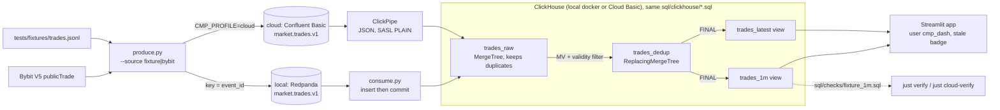

# CMP-ch architecture

Ingest writes only `trades_raw`. Everything downstream is the same SQL in both environments, so local and cloud differ only in transport and ingest. Decisions: [ADR-0001](../adr/0001-python-consumer-over-kafka-engine.md) · [0002](../adr/0002-replacingmergetree-with-final-views.md) · [0003](../adr/0003-clickpipes-for-cloud-ingest.md) · [0004](../adr/0004-streamlit-dashboard.md).

| Boundary | Contract | Spec |
|---|---|---|
| Producer → Kafka | normalized trade JSON, key `event_id` | [ingest](../../openspec/changes/add-local-redpanda-clickhouse-loop/specs/ingest/spec.md) |
| Kafka → `trades_raw` | at-least-once, 1:1 columns | ingest (+ [cloud delta](../../openspec/changes/add-clickhouse-cloud-clickpipes/specs/ingest/spec.md)) |
| `trades_raw` → `trades_dedup` | one row per `event_id` under `FINAL` | [storage-dedup](../../openspec/changes/add-local-redpanda-clickhouse-loop/specs/storage-dedup/spec.md) |
| Views → users | bar 4 / 0.45 / 70000 / 70010 / 69990 for the fixture | [ohlcv-marts](../../openspec/changes/add-local-redpanda-clickhouse-loop/specs/ohlcv-marts/spec.md), [dashboard](../../openspec/changes/add-local-redpanda-clickhouse-loop/specs/dashboard/spec.md) |
