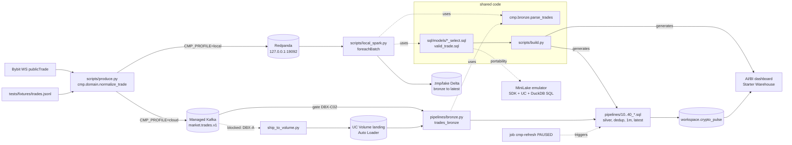

# Architecture — CMP-dbx-fe

One codebase and two runtimes. The local stack is for dev and debug only; production is managed Kafka + Databricks Free Edition. The rules are in the [constitution](../../.specify/memory/constitution.md) and the entities in the [data model](../../specs/001-local-kafka-spark-delta/data-model.md).

| Concern | Decision |
|---|---|
| Local tables | [ADR-0001](../adr/0001-path-based-delta-locally.md): path-based Delta + CTAS |
| SQL reuse | [ADR-0002](../adr/0002-shared-sql-models-and-build.md): `sql/models` + `build.py` |
| Cloud ingest | [ADR-0003](../adr/0003-kafka-from-pipeline-with-volume-fallback.md): Kafka pull, with the Volume push as the fallback |
| Emulator | [ADR-0004](../adr/0004-minilake-dmux-emulator.md): MiniLake for the SDK/SQL smoke only |
| Cost | [ADR-0005](../adr/0005-triggered-pipeline-paused-job.md): triggered pipeline, paused job |

Runbooks: [local dev/debug](../runbooks/local-dev-debug.md) · [Free Edition deploy/verify](../runbooks/dbx-fe-deploy-verify.md).
