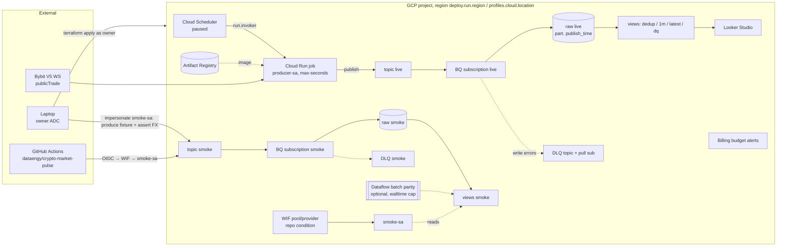

# Architecture — CMP-gcp cloud

The `live` and `smoke` envs are identical stacks (Terraform `for_each`). Only `live` has a hosted producer; only `smoke` is used by the laptop and CI. Dashed boxes are optional, gated, and off by default.

| Concern | Where |
|---|---|
| Ingest choice | [ADR-0001](../adr/0001-bq-subscription-over-dataflow.md) |
| Producer region | [ADR-0002](../adr/0002-cloud-run-job-region.md) |
| Identities | [ADR-0003](../adr/0003-keyless-auth-wif-impersonation.md) |
| Resource list | [terraform-foundation plan, Task 3](../../agent-os/specs/2026-10-30-1200-terraform-foundation/plan.md) |
| Local twin (emulators, shim, DirectRunner) | [01-local-dev-debug.md](../../../../docs/plans/gcp/01-local-dev-debug.md) |
