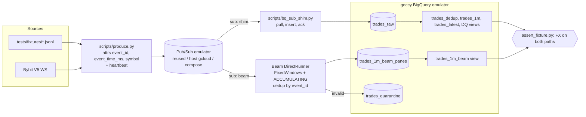

# Architecture Spine — CMP-gcp local dev & debug

## Design Paradigm
Pipes-and-filters. A pure core (`domain`, `reference`, `settings`) has no I/O. Adapters (`publish`, `bq_sink`, `sql`, the scripts) are thin and switch on **profile**, never on code forks. Layout: [plan §Layout](../../docs/plans/gcp/01-local-dev-debug.md#layout-cmp-gcp).

## Invariants & Rules

### AD-1 — One SQL dialect [ADOPTED]
- **Binds:** FR-5, FR-6, FR-10
- **Prevents:** emulator-only SQL forks that pass locally and fail in the cloud.
- **Rule:** `sql/bigquery/*.sql` is GoogleSQL with `{{dataset}}` / `{{lookback_days}}` placeholders. When the emulator can't run a query, it gets `skip_on_emulator` plus an entry in `docs/emulator-gaps.md`, and the SQL stays as it is. → [ADR-0001](adr/0001-bigquery-emulator-goccy.md)

### AD-2 — Strict config, no defaults [ADOPTED]
- **Binds:** all
- **Prevents:** silent fallbacks like the reference `profile="clickhouse"`.
- **Rule:** `settings.load(profile)` reads `config/config.yaml[profiles.
]` + `config/.env.common` (+ `.env.secrets` in the cloud) with `override=False`. A missing key raises `ValueError(<key>, <file>)`. Same pattern as [`CMP-dbx-fe/src/cmp/settings.py`](../../CMP-dbx-fe/src/cmp/settings.py).

### AD-3 — Event time from attributes; heartbeat closes windows
- **Binds:** FR-3, FR-7, FR-10
- **Prevents:** empty Beam output after a finite replay; processing-time bars.
- **Rule:** Beam reads `timestamp_attribute="event_time_ms"`, `id_label="event_id"`. Every fixture replay ends with one `kind=heartbeat` message at `last + window_s + allowed_lateness_s + 1s`. Both paths drop heartbeats.

### AD-4 — Late data accumulates; sink is append-only panes
- **Binds:** FR-7, FR-8, FR-11
- **Prevents:** a LATE pane replacing a bar with only its late trades (DISCARDING); DML in the sink.
- **Rule:** `AfterWatermark(late=AfterCount(1))`, `ACCUMULATING`, lateness from config. The sink appends `(symbol, window_start, pane_index, timing, …)`, and the view keeps the max `pane_index`. → [ADR-0003](adr/0003-dedup-and-late-data.md)

### AD-5 — Dedup key is `event_id` on both paths
- **Binds:** FR-6, FR-7, FR-10
- **Rule:** SQL: `QUALIFY ROW_NUMBER() OVER (PARTITION BY event_id ORDER BY received_at_ms, publish_time, message_id) = 1`. Beam: the combiner keeps the first-received copy per `event_id` (one `event_id` → one window). Delivery is at-least-once everywhere. Nothing claims exactly-once.

### AD-6 — Local stand-ins never ship
- **Binds:** FR-4, FR-6, FR-7
- **Rule:** the shim and `bq_sink.py` (DoFn) are `local` profile only. In the cloud, these are the BigQuery subscription and `WriteToBigQuery(STORAGE_WRITE_API)` ([ADR-0004](adr/0004-bq-subscription-shim.md)). Runner choice: [ADR-0002](adr/0002-directrunner-not-prism.md).

### AD-7 — Reuse before create; localhost only
- **Binds:** FR-1, FR-4
- **Rule:** follow the [reuse policy](../../crypto-market-pulse-chatgpt/project/docs/local/LOCAL_RUNTIME_REUSE_POLICY.md). Compose services bind 127.0.0.1, carry the label `com.crypto_market_pulse.owner`, and use `-p cmp-gcp`. `down` = stop the project's own services only; never `-v`, never prune.

Dependency direction: `scripts → adapters (publish, bq_sink, sql) → core (domain, reference, settings)`. The core imports nothing from adapters or scripts.

## Consistency Conventions
| Concern | Convention |
| --- | --- |
| Naming | package `cmp_gcp`; tables `trades_*`; just recipes `verb[-noun]` (`fault-late`, `debug-bq`) |
| IDs & time | `event_id = bybit:{category}:{symbol}:{trade_id}`; times are epoch ms `INT64`; money is `Decimal` / `BIGNUMERIC` strings, never float |
| Config | every scalar in `config/config.yaml` (sections in [plan §Layout](../../docs/plans/gcp/01-local-dev-debug.md#layout-cmp-gcp)); env only for profile, emulator hosts, secrets |
| Errors | invalid trades → tagged output / DQ view, never dropped silently; config errors → `ValueError` with key + file |
| Tests | `tests/unit`, `tests/beam` (TestStream, no network), `tests/it` (marker `needs_emulators`); expected values come from `reference.py` |
| Evidence | `.tmp/evidence/` (gitignored), workbook-05 template, expected vs actual |

## Stack
| Name | Version |
| --- | --- |
| Python / uv | 3.12 / pinned by `uv.lock` |
| apache-beam[gcp] | latest 2.x ≥ 2.68 (Prism is the DirectRunner default from 2.68), pinned in `uv.lock` at L02 |
| google-cloud-pubsub, google-cloud-bigquery | pinned in `uv.lock` |
| Pub/Sub emulator | host `gcloud` component, or `google-cloud-cli:emulators` (pinned tag) |
| BigQuery emulator | `ghcr.io/goccy/bigquery-emulator` (pinned tag, multi-arch) |

## Capability → Architecture Map
| Capability | Lives in | Governed by | Story |
| --- | --- | --- | --- |
| FR-1 discovery | `scripts/discover.py`, `just discover` | AD-7 | [1.1](stories/1.1.story.md) |
| FR-2 settings | `src/cmp_gcp/settings.py`, `config/` | AD-2 | [1.2](stories/1.2.story.md) |
| FR-3 producer | `domain.py`, `bybit_ws.py`, `publish.py`, `scripts/produce.py` | AD-3, AD-5 | [1.3](stories/1.3.story.md) |
| FR-4 emulators | `compose.yml`, `just up/down` | AD-7 | [2.1](stories/2.1.story.md) |
| FR-5 SQL | `sql/bigquery/`, `sql.py`, `scripts/sql_apply.py` | AD-1 | [2.2](stories/2.2.story.md) |
| FR-6 shim | `scripts/bq_sub_shim.py` | AD-5, AD-6 | [2.3](stories/2.3.story.md) |
| FR-7 Beam | `beam_pipeline.py`, `bq_sink.py`, `scripts/beam_run.py` | AD-3–AD-6 | [3.1](stories/3.1.story.md) |
| FR-8 TestStream | `tests/beam/` | AD-4, AD-5 | [3.2](stories/3.2.story.md) |
| FR-9 debug | `just debug-*`, notebook | — | [3.3](stories/3.3.story.md) |
| FR-10 E2E | `scripts/assert_fixture.py`, `tests/it/` | AD-1, AD-5 | [4.1](stories/4.1.story.md) |
| FR-11 faults | `just fault-*`, fixtures `trades_late`, `trades_poison` | AD-4 | [4.2](stories/4.2.story.md) |
| FR-12 live | `produce --source bybit` | AD-2 | [4.3](stories/4.3.story.md) |
| FR-13 CI | `.github/workflows/` (repo root; path filter `CMP-gcp/**`) | NFR-3 | [4.4](stories/4.4.story.md) |

## Deferred
- Cloud sinks, IAM, Terraform, Dataflow and drain/update semantics → `GCP-C*` / [`../deploy/`](../deploy/README.md). The local profile cannot prove them.
- DuckDB fallback ([L14](../../docs/plans/gcp/tasks.md#gcp-l14)) — only if the L05 gaps block the SQL path.
- Prism + `ReadFromPubSub` ([L15](../../docs/plans/gcp/tasks.md#gcp-l15)) — after L09.
- Unbounded-state dedup (combiner accumulator growth) — fine at fixture and smoke scale; it is a cloud concern.
